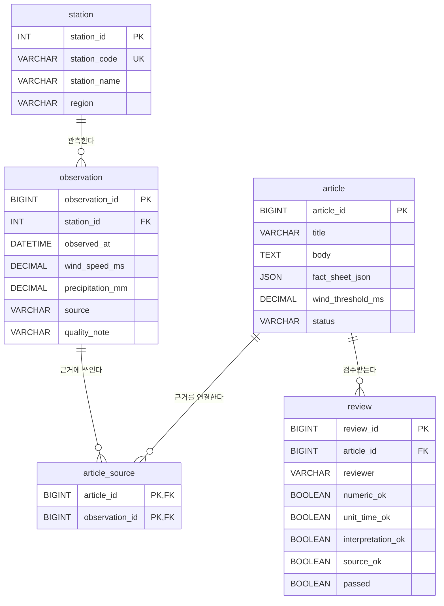

# 04. MySQL DB 설계서 · ERD — Drone Weather News Lab

- 작성일: 2026-10-19
- 범위: 문제 1-1 기획·설계(20점 중 DB 설계 항목)
- 상태: **설계 완료 / 실제 MySQL 생성 및 테스트는 아직 미실행**
- 대상: 서울 ASOS 관측지점(정확한 지점번호는 실제 수집 시 검증)
- 기술: MySQL 8.x, Python, FastAPI
- 목적: 기상 관측의 출처·시각을 보존하고 AI 기사의 근거 및 사람 검수 이력을 추적한다.

## 1. 초보자를 위한 용어

- **DB(Database)**: 기상자료와 기사를 보관하는 전자 서류함.
- **테이블(Table)**: 서류함 속 각각의 서랍(엑셀 표처럼 행·열로 구성).
- **행(Row)**: 하나의 기록(예: 어느 시각의 풍속 관측 1건).
- **열(Column)**: 기록의 항목(예: 관측 시각, 풍속).
- **PK(Primary Key, 기본키)**: 기록마다 붙이는 중복 없는 고유 번호. 학생의 학번처럼 생각하면 된다.
- **FK(Foreign Key, 외래키)**: 다른 표의 기록을 가리키는 연결 번호.
- **ERD(Entity Relationship Diagram)**: 서랍끼리 무엇으로 연결되어 있는지 보여주는 관계도.
- **CRUD**: 데이터 등록(C), 조회(R), 수정(U), 삭제(D).

## 2. 테이블 5개

| 테이블 | 쉬운 의미 | 주요 열·자료형 | 기본키(PK) | 외래키(FK) |
|---|---|---|---|---|
| `station` | 기상 관측지점 명부 | `station_id` INT, `station_code` VARCHAR(20), `station_name` VARCHAR(100), `region` VARCHAR(50) | `station_id` | 없음 |
| `observation` | 관측값 서랍 | `observation_id` BIGINT, `station_id` INT, `observed_at` DATETIME, `wind_speed_ms` DECIMAL(6,2) NULL, `precipitation_mm` DECIMAL(8,2) NULL, `source` VARCHAR(200), `quality_note` VARCHAR(255) | `observation_id` | `station_id` → `station.station_id` |
| `article` | AI 뉴스 기사 | `article_id` BIGINT, `title` VARCHAR(200), `body` TEXT, `model_name` VARCHAR(100), `prompt_text` TEXT, `fact_sheet_json` JSON, `wind_threshold_ms` DECIMAL(6,2), `status` VARCHAR(10), `created_at` DATETIME | `article_id` | 없음 |
| `article_source` | 기사와 관측값 연결 표 | `article_id` BIGINT, `observation_id` BIGINT | 두 열을 합친 복합 PK | 각각 `article`, `observation` 참조 |
| `review` | 검수 기록 | `review_id` BIGINT, `article_id` BIGINT, `reviewer` VARCHAR(100), `numeric_ok` BOOLEAN, `unit_time_ok` BOOLEAN, `interpretation_ok` BOOLEAN, `source_ok` BOOLEAN, `passed` BOOLEAN, `comment` TEXT, `reviewed_at` DATETIME | `review_id` | `article_id` → `article.article_id` |

### 관측 데이터 설계 원칙

- 하나의 관측지점에서 같은 시각의 기록이 중복 저장되지 않도록 `UNIQUE(station_id, observed_at)`을 둔다.
- 관측값 누락은 `NULL`로 저장하고 **0으로 임의 변경하지 않는다**. `0 mm` 강수량과 `NULL`은 뜻이 다르다.
- 풍속 단위는 m/s, 강수량 단위는 mm이다. 시간별 강수 컬럼의 정의·누적/시간 기준은 실제 기상청 자료 설명을 확인한 뒤 확정한다.
- 분석용 풍속 기준(예: 5.0 m/s)은 법적 드론 비행 허가 기준이 아니다. 실제 기본값은 사용자가 정한 뒤 기사에 반드시 표시한다.
- `article.fact_sheet_json`은 기사 생성 당시 수치의 근거 스냅샷이다. `article_source`는 개별 근거 관측 레코드의 연결을 기록한다.
- 기사 승인 결정은 **최신 검수 4개 항목 모두 통과**한 경우에만 서버에서 허용한다. 검수 실패 또는 검수기록이 없으면 승인 금지. 단순 DB 구조만으로 이 규칙이 완성되지는 않으며 FastAPI 로직과 테스트가 필요하다.

## 3. ERD: 테이블 연결 그림



**읽는 법:** 하나의 관측지점(`station`)에는 관측 기록(`observation`)이 여러 건 들어갈 수 있다. 하나의 기사에는 여러 관측기록이 근거로 사용될 수 있고, 같은 관측기록이 여러 기사에 쓰일 수도 있으므로 중간 연결표(`article_source`)를 둔다. 한 기사는 수정·재검수 과정에서 여러 검수 기록(`review`)을 가질 수 있다.

## 4. MySQL 생성 SQL (다음 개발 단계에서 실행할 설계안)

```sql
CREATE DATABASE IF NOT EXISTS drone_weather_news
  CHARACTER SET utf8mb4 COLLATE utf8mb4_unicode_ci;
USE drone_weather_news;

CREATE TABLE station (
    station_id INT AUTO_INCREMENT PRIMARY KEY,
    station_code VARCHAR(20) NOT NULL UNIQUE,
    station_name VARCHAR(100) NOT NULL,
    region VARCHAR(50) NOT NULL
);

CREATE TABLE observation (
    observation_id BIGINT AUTO_INCREMENT PRIMARY KEY,
    station_id INT NOT NULL,
    observed_at DATETIME NOT NULL,
    wind_speed_ms DECIMAL(6,2) NULL,
    precipitation_mm DECIMAL(8,2) NULL,
    source VARCHAR(200) NOT NULL,
    quality_note VARCHAR(255) NULL,
    CONSTRAINT fk_observation_station
       FOREIGN KEY (station_id) REFERENCES station(station_id),
    CONSTRAINT uq_station_time UNIQUE (station_id, observed_at),
    CONSTRAINT chk_wind_nonnegative CHECK (wind_speed_ms IS NULL OR wind_speed_ms >= 0),
    CONSTRAINT chk_precip_nonnegative CHECK (precipitation_mm IS NULL OR precipitation_mm >= 0)
);

CREATE TABLE article (
    article_id BIGINT AUTO_INCREMENT PRIMARY KEY,
    title VARCHAR(200) NOT NULL,
    body TEXT NOT NULL,
    model_name VARCHAR(100) NOT NULL,
    prompt_text TEXT NULL,
    fact_sheet_json JSON NOT NULL,
    wind_threshold_ms DECIMAL(6,2) NOT NULL,
    status VARCHAR(10) NOT NULL DEFAULT '검토대기',
    created_at DATETIME NOT NULL DEFAULT CURRENT_TIMESTAMP,
    CONSTRAINT chk_article_status CHECK (status IN ('검토대기','승인','보류')),
    CONSTRAINT chk_threshold_nonnegative CHECK (wind_threshold_ms >= 0)
);

CREATE TABLE article_source (
    article_id BIGINT NOT NULL,
    observation_id BIGINT NOT NULL,
    PRIMARY KEY (article_id, observation_id),
    CONSTRAINT fk_article_source_article
      FOREIGN KEY (article_id) REFERENCES article(article_id) ON DELETE CASCADE,
    CONSTRAINT fk_article_source_observation
      FOREIGN KEY (observation_id) REFERENCES observation(observation_id)
);

CREATE TABLE review (
    review_id BIGINT AUTO_INCREMENT PRIMARY KEY,
    article_id BIGINT NOT NULL,
    reviewer VARCHAR(100) NOT NULL,
    numeric_ok BOOLEAN NOT NULL,
    unit_time_ok BOOLEAN NOT NULL,
    interpretation_ok BOOLEAN NOT NULL,
    source_ok BOOLEAN NOT NULL,
    passed BOOLEAN NOT NULL,
    comment TEXT NULL,
    reviewed_at DATETIME NOT NULL DEFAULT CURRENT_TIMESTAMP,
    CONSTRAINT fk_review_article
      FOREIGN KEY (article_id) REFERENCES article(article_id) ON DELETE CASCADE
);
```

### 삭제·승인 주의사항

- 관측자료를 기사 근거로 사용 중이면 DB의 외래키 제약에 따라 해당 `observation` 레코드 삭제를 차단한다. 테스트 시 존재하지 않는 ID와 근거로 사용 중인 관측 기록 삭제 오류를 구분한다.
- 기사 삭제 시 연결된 `article_source` 및 `review`는 DB에서 연쇄 삭제된다. 평가용 이력을 유지하려면 실제 운영에서는 삭제 정책을 다시 설계해야 한다.
- `review.passed`는 검수 결과의 요약이고, 실제 승인 전 서버가 검수 항목 전체와 최신 검수 결과를 재검증해야 한다.
- 리뷰 기록이 비어 있거나 보류라면 `PUT /articles/{id}/approve`는 HTTP 400으로 차단하도록 구현할 계획이다.
- 역할별 로그인, PostgreSQL/Supabase 전환은 추가 설계 대상이며 **이번 MySQL 스키마에 구현 완료로 표시하지 않는다.**

## 5. 기능·화면·DB 연결

| 기능 | 화면 | DB 테이블 |
|---|---|---|
| F01·F02·F03 수집/저장/CRUD | S02 관측자료 | `station`, `observation` |
| F04 Fact Sheet 분석 | S03 분석 | `observation` 조회 → 계산 후 JSON |
| F05 AI 기사 생성 | S04 AI 기사 | `article`, `article_source` |
| F06·F07 검수·승인 | S05 검수·승인 | `review`, `article` |
| F08 승인 뉴스 표시 | S06 공개 뉴스 | `article` (status='승인') |

## 6. 평가·제출 체크

- **평가:** 문제 1-1(20점)의 `DB 설계서(ERD, PK/FK)` 항목. 단독 20점이 아니며 기획·기능·화면·출처·환경과 합산된다.
- **답안지:** 문제 1-1의 ‘데이터베이스 설계서(MySQL)’ 표에 5개 테이블과 PK/FK 관계를 옮긴다. 가능하다면 ERD 그림/화면을 추가한다.
- **현재 캡처:** 실제 실행 화면 없음. 문서에 있는 ERD는 설계안이다.
- **다음 캡처:** MySQL Workbench에서 CREATE TABLE 실행 후 테이블 목록, `SHOW CREATE TABLE` 또는 PK/FK, SELECT 결과를 캡처한다.
- **저장 위치:** `AI_뉴스_평가_제출준비/01_기획설계/04_DB설계서_MySQL_ERD_드론_기상정보_뉴스.md`.
- **GitHub 첫 커밋:** PRD·기능정의서·화면설계서·본 문서가 확정되면 신규 드론 전용 저장소에 Commit 1을 남긴다. 비밀정보(.env, DB 비밀번호)는 절대 올리지 않는다. 최종 목표는 의미 있는 커밋 5회 이상.
- **현재 미구현:** 실제 MySQL 테이블 생성, 실제 CSV/API 수집, 데이터 저장, 승인 차단 서버 로직 및 테스트.

## 7. 다음 단계

1. 새 프로젝트 폴더에 `schema.sql`로 SQL을 별도 저장한다.
2. MySQL 연결 확인 후 테이블을 생성하고 PK/FK를 검증한다.
3. 실제 기상청 자료 컬럼명·관측 지점·기간을 확인하고 변환 규칙을 확정한다.
4. 관측 데이터 수집·CRUD 테스트로 넘어간다.

> 참고: 공식 평가 답안지의 `MySQL·PK/FK·검수 이력` 요구사항을 반영하되 예시의 날씨 도시별 테이블을 복사하지 않고 드론 기상 관측 도메인에 맞게 변경했다.
