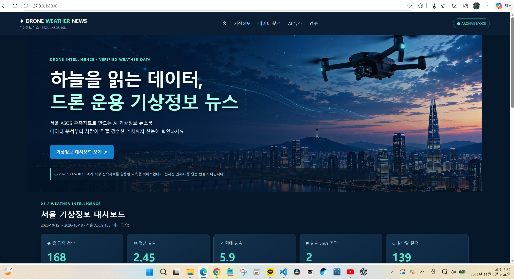
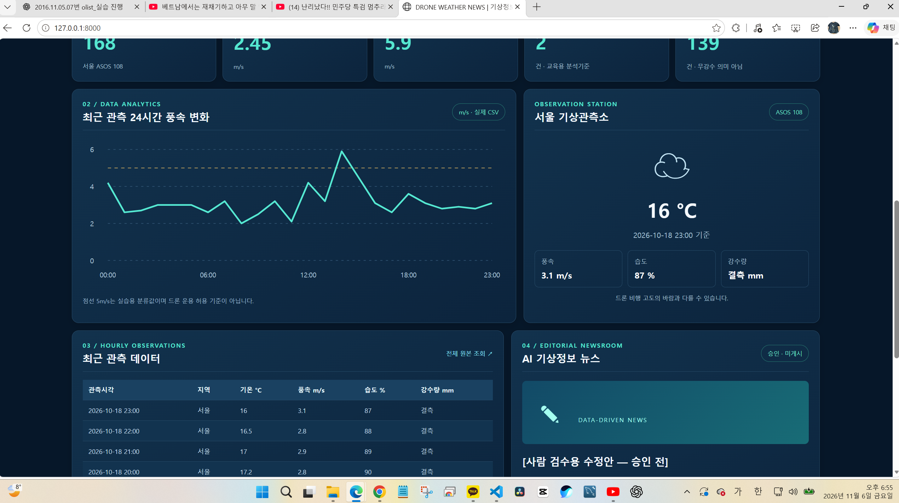
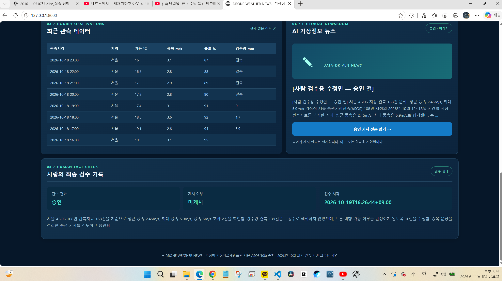
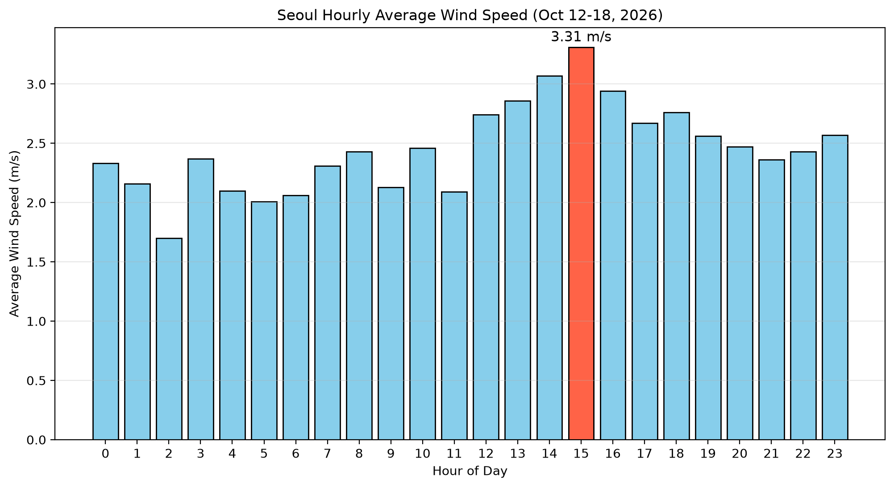

# 🚁 드론 운용 기상정보 뉴스 | Drone Weather News

**서울 ASOS 실측 168건 → MySQL 저장·검증 → Fact Sheet → OpenAI 기사 작성 → 사람 검수·승인 → FastAPI 웹 대시보드**

> **프로젝트 성격:** 기상청 과거 지상 관측자료를 분석해 드론 운용 관련 **기상정보 뉴스를 제작하는 교육용 웹 프로젝트**입니다. 실시간 관제, 비행 가능 여부 판단, 비행 허가 서비스가 아닙니다.

## 🔎 평가자용 1분 요약

| 평가 포인트 | 직접 구현·검증한 내용 | 확인 위치 |
|---|---|---|
| 기획·설계 | PRD, 기능정의서, 화면설계서, MySQL DB 설계 | [docs/](docs/) |
| 원천 데이터·정제 | 기상청 서울 ASOS **108번**, 2026-10-12~18, **168개 시간 관측** | [원본 CSV](data/raw/OBS_ASOS_TIM_20261019111228.csv), [분석 코드](scripts/02_analyze_seoul_asos.py) |
| 데이터 검증 | 평균 풍속 **2.45m/s**, 최대 **5.9m/s**, 5m/s 초과 **2건**; 강수량 결측 **139건** | [Fact Sheet](data/processed/01_drone_weather_fact_sheet.json) |
| MySQL 설계·적재 | **5개 테이블**: station, observation, article, article_source, review; 서울 관측자료 168건 | [database/](database/), [적재 코드](scripts/04_import_asos_mysql.py) |
| CRUD 구현 | MySQL 직접 CRUD 및 **FastAPI POST/PATCH/DELETE**로 실습자료 등록·수정·삭제 | [CRUD API](app/routers/mysql_observations.py), [트랜잭션 SQL](database/05_mysql_crud_transaction_test.sql) |
| 데이터 보호 | 실제 관측소 **108 읽기 전용**, 쓰기는 테스트 관측소 9999와 `CRUD_API_TEST` 출처만 허용; 기본 쓰기 비활성화 | [API 구현](app/routers/mysql_observations.py), [.env.example](.env.example) |
| AI 기사·사람 검수 | OpenAI로 기사 초안 작성 → 수치·표현 점검 → 사람이 수정 기사 승인; **게시 상태는 미게시** | [기사·검수 결과](articles/), [생성 코드](scripts/03_generate_openai_news.py) |
| 웹 디자인·시각화 | 서울 야경·드론 배경, 통계 카드 5개, 풍속 그래프, 최근 관측표, AI 뉴스·검수 결과 | [웹 HTML](app/templates/index.html), [CSS](app/static/css/style.css), [이미지](app/static/images/seoul-drone.jpg) |
| 테스트 | **pytest 9개 통과**(로컬 실행 확인); FastAPI와 MySQL 실제 5건 조회 및 CRUD 시연 | [tests/](tests/), [MySQL 최종 SQL](database/06_mysql_final_data_integrity_check.sql) |

### 실제 검증 결과 (2026-10-20, 로컬 학원 PC 실행)

| 검증 | 결과 |
|---|---|
| `python -m pytest -q` | **9 passed** |
| FastAPI `GET /api/mysql/observations?limit=5` | **200 OK**, 서울 관측자료 5건 |
| `POST /api/mysql/demo` | **201 Created**, 테스트 ID **171** |
| `PATCH /api/mysql/demo/171` | **200 OK**, 풍속 **3.0 → 4.5m/s** |
| `DELETE /api/mysql/demo/171` | **200 OK**, 테스트 자료 삭제 |
| `GET /api/mysql/demo` | **200 OK**, `{"rows":[]}` |
| MySQL 최종 SQL 조회 | 전체 **168**, 서울 **168**, 남은 API 테스트 자료 **0** |

**중요:** 위 결과는 당시 로컬 실행과 화면 캡처로 확인한 값입니다. GitHub 저장소에 학원 PC의 MySQL 데이터 자체가 들어 있는 것은 아닙니다. pytest 9개는 웹/API 정책 단위 테스트이며, 실제 DB CRUD는 별도 수동 실행으로 검증했습니다.

## 🖥️ 실행 방법 — Windows 11 / VS Code / PowerShell

GitHub에서 저장소 내려받기 (처음 한 번만):

```powershell
git clone https://github.com/heumpc0922/drone-weather-news.git
cd drone-weather-news
```

이미 내려받았다면 VS Code에서 해당 폴더를 열고 터미널에서 `git pull origin main`을 실행합니다.

```powershell
# 1. 가상환경 생성 (처음 한 번만)
py -m venv .venv

# 2. 가상환경 활성화 (새 터미널마다)
.\.venv\Scripts\Activate.ps1

# 3. 패키지 설치
python -m pip install -r requirements.txt

# 4. MySQL 실습을 할 때만 환경 파일 생성 (기존 .env가 있으면 생략!)
Copy-Item .env.example .env

# 5. 서버 실행 (MySQL 실습을 할 때만 먼저 .env에 접속정보 설정)
python -m uvicorn app.main:app --reload
```

> `.env`에 `MYSQL_HOST`, `MYSQL_PORT`, `MYSQL_USER`, `MYSQL_PASSWORD`, `MYSQL_DATABASE`를 로컬 DB에 맞게 설정합니다. **`ENABLE_DEMO_CRUD=false`를 유지**하세요. OpenAI API 키는 기사 생성 프로그램을 새로 실행할 때만 필요합니다. 비밀번호나 키는 절대 GitHub에 올리지 않습니다.

- **웹사이트:** http://127.0.0.1:8000
- **대화형 API 문서(Swagger):** http://127.0.0.1:8000/docs
- **자동 테스트:** `python -m pytest -q`
- **MySQL 연결 확인:** `python scripts/03_test_mysql_connection.py`
- **종료:** 서버 실행 중 터미널에서 `Ctrl+C`

MySQL이 없는 환경에서도 저장된 CSV·Fact Sheet 기반 대시보드와 기본 API는 실행 가능하지만, **`/api/mysql/*`는 별도 MySQL Server와 데이터베이스 준비가 필요**합니다. MySQL 초기화·적재는 [스키마 SQL](database/01_drone_weather_schema.sql), [기초 데이터 SQL](database/02_drone_weather_data.sql), [CSV 적재 코드](scripts/04_import_asos_mysql.py)를 참조하세요. 학원 DB를 다른 PC로 복원하려면 별도 SQL Dump가 필요합니다. 기존 데이터가 있으면 중복 적재하지 마세요.

PowerShell에서 활성화가 차단되면 현재 터미널에서만 다음을 실행합니다: `Set-ExecutionPolicy -Scope Process -ExecutionPolicy Bypass`.

## 🧩 주요 API 및 구현 구분

| 엔드포인트 | 용도 |
|---|---|
| `GET /` | 드론 기상정보 뉴스 웹 대시보드 |
| `GET /api/weather` | 검증된 Fact Sheet 통계 |
| `GET /api/observations?limit=24` | **CSV 기반** 시간별 관측자료 (홈페이지 그래프·표) |
| `GET /api/hourly-wind` | 서울 ASOS 108번의 00~23시 평균 풍속·건수와 평균이 가장 높은 시간대 |
| `GET /api/article` | 승인된 수정 기사 열람 |
| `GET /api/review` | 사람 검수·게시 상태 |
| `GET /api/mysql/observations?limit=5` | **MySQL 기반** 서울 관측자료 조회 |
| `GET /api/mysql/demo` | 테스트 자료만 조회 |
| `POST /api/mysql/demo`, `PATCH /api/mysql/demo/{id}`, `DELETE /api/mysql/demo/{id}` | 로컬 교육용 테스트 관측자료 CRUD |

**웹 대시보드의 그래프는 CSV를 읽으며, MySQL 실측 조회는 별도 API에서 수행합니다.** 두 방식을 혼동하지 않도록 구분했습니다.

실습용 쓰기 API는 로그인·인증이 없으므로 기본적으로 **403 차단**합니다. 실습이 꼭 필요한 경우에만 로컬 `.env`에서 `ENABLE_DEMO_CRUD=true`로 잠시 열고, 실습 후 반드시 `false`로 복구합니다. 공개 서버에서는 활성화하면 안 됩니다.

## 📁 핵심 파일 찾아보기

```text
docs/                      기획서·기능·화면·DB 설계
data/raw/                  기상청 CSV 원본
data/processed/            검증 Fact Sheet JSON
database/                  MySQL 스키마·적재·조회·CRUD·최종 검증 SQL
scripts/                   Python 자료분석·MySQL 적재·OpenAI 기사·승인
articles/                  AI 기사 초안·수정본·사람 검수·승인 기록
app/main.py                FastAPI 실행 진입점
app/database.py            MySQL 연결
app/routers/mysql_observations.py  MySQL 조회·교육용 CRUD
app/templates/index.html   웹 화면
app/static/                CSS·JavaScript·드론 배경사진
tests/                     pytest 자동 테스트
.env.example               환경변수 예시 (비밀정보 없음)
requirements.txt           실행 라이브러리
```

## ✅ 제작 과정과 검수·한계

1. 기상청 ASOS(서울 108) 시간별 원본 CSV 수집 및 Python 분석.
2. MySQL 5개 테이블 설계·적재; 제약조건 검사(습도 150% 입력 거부).
3. 실제 수치만 포함한 Fact Sheet 정리 및 OpenAI로 AI 기사 초안 생성.
4. 사람이 수치·표현을 확인하고 수정 기사 승인. 승인 정보는 [08_article_approval.json](articles/08_article_approval.json)에 저장; **`published:false`**는 미게시를 뜻함.
5. FastAPI 기반 기상정보 뉴스 웹페이지와 MySQL CRUD 데모 구축, 자동 테스트 및 실제 DB CRUD 검증.

**해석 주의:** 이 데이터는 **2026-10-12~18의 과거 지상 관측자료**입니다. 비행 고도 바람·현장 기상을 보장하지 않고 비행 가능 여부나 법적 허가를 판단하지 않습니다. 5m/s는 **학습용 분석 구분값**일 뿐 일률적 비행 제한 기준이 아닙니다. 강수량 결측 **139건을 무강수로 해석하지 않았습니다.** 배경 이미지는 제작된 콘셉트 이미지이며 실제 특정 시점 촬영사진이 아닙니다.

**구현 범위 밖:** 실시간 관측 자동 갱신, 항공 안전 판정·지도, 사용자 로그인/권한 인증, 외부 공개 배포. 평가 시 완성 기능으로 오인되지 않도록 구분합니다.

---

**GitHub 제출 링크:** https://github.com/heumpc0922/drone-weather-news

**시연 순서 추천:** (1) `/` 웹디자인·그래프·AI 뉴스 → (2) `/docs`의 MySQL 조회 → (3) `python -m pytest -q` 9개 통과 → (4) `database/06_mysql_final_data_integrity_check.sql`로 **168 / 168 / 0** 확인.


## 이용 조건

이 프로젝트의 **코드, 관측자료, 분석 결과, AI 기사, 이미지에는 서로 다른 이용 조건**이 적용될 수 있습니다. 아래에 출처와 확인된 범위, 재사용 시 주의사항을 구분합니다.

| 자료 구분 | 출처 및 제작·사용 내역 | 공개·재이용 조건 |
|---|---|---|
| 프로젝트 코드 | 이 저장소에서 직접 작성했거나 배포 권한이 있는 Python·HTML·CSS 등 코드 | **MIT License** 적용. 원문은 [LICENSE](LICENSE) 참고. 제3자 자료에는 자동 적용되지 않음 |
| 기상 관측 원본 | **기상청 기상자료개방포털**, 서울 ASOS **108번**, **2026-10-12~18** 시간별 관측 168건. [원본 CSV](data/raw/OBS_ASOS_TIM_20261019111228.csv) | 자료 출처를 **기상청 기상자료개방포털**로 표시. 원본의 개별 공공누리 표시·이용 조건은 재배포 전에 확인 |
| 분석 데이터·Fact Sheet | 위 기상청 원본을 Python으로 집계·가공한 프로젝트 분석 결과. [분석 코드](scripts/02_analyze_seoul_asos.py), [Fact Sheet](data/processed/01_drone_weather_fact_sheet.json) | 분석·가공 사실과 원본 출처를 함께 표시. 가공했다고 원본 자료의 권리가 사라지는 것은 아님 |
| AI 기사 초안 | [생성 스크립트](scripts/03_generate_openai_news.py)에서 **OpenAI API / `gpt-5-mini`**를 사용하도록 지정. [AI 초안](articles/04_ai_news_draft.txt) | **AI 생성 초안**임을 표시하고 원본 수치·표현을 사람에게 검수받은 뒤 이용. 외부 인용문이 있다면 별도 출처 확인 |
| 사람 검수·수정 기사 | [검수 보고서](articles/05_article_review_report.md), [수정 기사](articles/06_revised_drone_weather_article.txt), [승인 기록](articles/08_article_approval.json) | 승인 기록상 **사람 검수일: 2026-10-19**, **미게시(`published:false`)**. 이는 AI 초안 생성일과 다르며, 생성 일시는 저장된 자료만으로 확인되지 않음 |
| 웹 배경 이미지 | [`app/static/images/seoul-drone.jpg`](app/static/images/seoul-drone.jpg). 프로젝트 설명상 **서울·드론 콘셉트 이미지**로, 실제 특정 시각의 촬영 증거가 아님 | **제작 도구·제작 날짜·원저작물·권리자의 허락 여부는 저장소에서 확인되지 않음**. 따라서 MIT 적용 대상이라고 단정하지 않으며, 제3자가 재사용하려면 별도 권리 확인이 필요 |

### 출처 및 권리 관련 참고

- 기상청 자료 제공처: [기상자료개방포털](https://data.kma.go.kr/)  
- 기상청의 공식 [저작권 보호 및 정책](https://data.kma.go.kr/cmmn/static/staticPage.do?page=pageCr): 기상청이 권리를 보유하고 **공공누리 제1유형**으로 표시한 저작물은 **출처를 밝히고 이용**할 수 있습니다. 다만 **이 CSV 파일에 어떤 유형 표시가 붙어 있는지는 별도로 확인해야 하며**, 기상청 자료 전체에 일괄적으로 제1유형을 선언하는 것은 아닙니다.
- OpenAI 모델 및 생성 방식: [생성 스크립트](scripts/03_generate_openai_news.py)를 통해 확인 가능. **AI 모델을 사용했다는 사실과 사람의 최종 책임**을 구분합니다.
- 별도로 제3자 기사 문구, 사진·로고 등을 추가할 경우 **원저작자·원문 URL·인용 범위·이용 허락**을 개별 확인하여 출처를 기록합니다.

> **윤리·법적 책임:** 이 저장소의 MIT License는 작성자가 권리를 가진 **코드**의 이용 조건입니다. **기상청 원본 데이터, 제3자 인용물, 배경 이미지에 대한 재사용 허락을 대신하지 않습니다.** 확인되지 않은 이용 권한은 허락받은 것으로 표시하지 않습니다.

## 📸 프로젝트 실행 화면 및 데이터 분석 결과

### ① 드론 기상정보 뉴스 메인 화면

기상청 서울 ASOS 관측자료를 활용한 드론 기상정보 뉴스 프로젝트입니다.



### ② 기상 데이터 분석 및 시각화

2026년 10월 12일부터 18일까지 서울 ASOS 관측자료 168건을 분석했습니다.

- 평균 풍속: 2.45m/s
- 최대 풍속: 5.9m/s
- 풍속 5m/s 초과: 2건
- 강수량 결측: 139건

※ 5m/s는 교육용 분석 기준이며, 드론 비행 허가 기준이 아닙니다.
※ 강수량 결측은 무강수를 의미하지 않습니다.



### ③ AI 뉴스 생성 및 사람의 최종 검수

분석 결과를 바탕으로 AI 기사 초안을 작성하고 사람이 수치와 표현을 검수했습니다.

기사 승인과 실제 게시는 별개이며, 현재 게시 상태는 미게시입니다.



---

## 📊 추가 데이터 분석 — 서울 시간대별 평균 풍속

### 1. 분석 목적

2026년 10월 12일부터 18일까지 서울 ASOS 기상 관측자료를 활용하여 시간대별 평균 풍속을 비교하고, 평균 풍속이 가장 높은 시간을 확인했습니다.

### 2. 사용 데이터

- 출처: 기상청 기상자료개방포털
- 관측 지역: 서울(지점번호 108)
- 관측 기간: 2026년 10월 12일~18일
- 전체 관측자료: 168건
- 분석에 사용한 자료: 168건
- 분석 시간대: 0시~23시
- 시간대별 관측 건수: 각 7건

### 3. 추가한 데이터 분석기법

- Pandas를 이용한 CSV 데이터 처리
- 날짜 및 시간 데이터 변환
- 결측치 확인 및 제외
- groupby()를 이용한 시간대별 그룹화
- mean()을 이용한 평균 풍속 계산
- Matplotlib을 이용한 막대그래프 시각화

### 4. 분석 결과

- 평균 풍속이 가장 높은 시간: 15시(오후 3시)
- 해당 시간의 평균 풍속: 3.31m/s
- 전체 24개 시간대에서 각각 7건의 관측자료 확인
- 분석에서 제외된 기록: 0건

### 5. 데이터 시각화



### 6. 분석 코드

- Python 파일: `scripts/08_hourly_wind_analysis.py`
- 원본 데이터: `data/raw/OBS_ASOS_TIM_20261019111228.csv`
- 사용 라이브러리: Pandas, Matplotlib

실행 명령어:

```powershell
python -m pip install pandas matplotlib
python scripts/08_hourly_wind_analysis.py
```

### 7. FastAPI와 웹 대시보드에서 확인

[FastAPI](app/main.py)의 `GET /api/hourly-wind`가 기상청 서울 ASOS 108번의 CSV를 직접 읽습니다. 관측 시각과 풍속이 유효한 행을 시각의 시(00~23시)로 묶어 평균 풍속(m/s, 소수점 둘째 자리)과 관측 건수를 계산합니다. 값이 없는 시간대는 평균 `null`, 건수 0으로 반환합니다. `strongest_hour`에는 평균이 가장 높은 시간대가 들어갑니다.

[웹 화면](app/templates/index.html)의 [JavaScript](app/static/js/app.js)는 이 API를 호출해 막대그래프를 그리며, 가장 높은 시간대를 주황색으로 강조합니다. 기존 24시간 풍속 그래프는 최근 24개 관측값을, 새 그래프는 7일에 걸친 **시간대별 평균**을 보여 줍니다.

1. 위 Windows 실행 안내에 따라 패키지를 설치한 다음 `python -m uvicorn app.main:app --reload`를 실행합니다. CSV 기반 대시보드를 보는 데는 `.env`, MySQL 서버, OpenAI 키가 필요하지 않습니다.
2. [서울 시간대별 평균 풍속 그래프](http://127.0.0.1:8000/#hourly-wind)를 열어 **15시 (3.31 m/s)**가 강조되는지 확인합니다.
3. [풍속 API](http://127.0.0.1:8000/api/hourly-wind)를 열거나, 서버를 켜 둔 상태로 새 PowerShell에서 아래 명령을 실행합니다.

```powershell
$wind = Invoke-RestMethod 'http://127.0.0.1:8000/api/hourly-wind'
$wind.rows.Count            # 24
$wind.rows[15].count        # 7
$wind.strongest_hour        # hour=15, average_wind_speed_ms=3.31
```

`127.0.0.1`은 실행 중인 컴퓨터에서만 열립니다. 공개 HTTPS 주소는 배포 및 외부 접속 검증이 끝난 뒤 안내합니다.

---

## 🚁 5차 자동 팩트체킹 실습 — 드론 기상안전 RAG

### 1. 프로젝트 개요

2026년 11월 9일 진행한 AI 기반 데이터 저널리스트 양성 과정의
5차 자동 팩트체킹 실습 결과입니다.

기존 드론 기상정보 뉴스 프로젝트에
기상청 ASOS 관측자료, 항공안전법 시행규칙,
드론원스톱 민원서비스 안내자료,
DJI Mini 4 Pro 사용자 매뉴얼을 활용한
근거 기반 질문·답변 기능을 추가했습니다.

### 2. 구현한 주요 기능

- 기상청 서울 ASOS 관측자료 분석
- 기상 관측 수치와 JSON 사실표 자동 비교
- 사실ID(F-1~F-6) 기반 근거 관리
- 사실ID 직접 검색
- 질문 속 키워드를 이용한 사실 검색
- OpenAI API를 이용한 근거 기반 답변 생성
- 답변에 사실ID 표시
- 등록된 근거가 없는 질문에 확인 불가 응답

### 3. RAG 구현 방식

질문 입력
→ 키워드 검색
→ JSON 사실표에서 관련 사실ID 조회
→ 검색된 근거를 OpenAI API에 전달
→ AI 답변 생성 및 사실ID 표시

현재는 JSON 사실표 기반의 기초 RAG 실습입니다.

PDF 원문 전체를 자동 검색하는 문서형 RAG,
벡터 데이터베이스 검색,
실시간 기상정보 갱신 기능은 구현하지 않았습니다.

본 프로젝트는 교육용 팩트체킹 시스템이며,
실제 드론 비행 가능 여부를 판단하거나
비행승인을 제공하는 서비스가 아닙니다.

### 4. 드론 기상안전 사실표(Fact Sheet)

기상청 서울 ASOS 관측자료와 드론 안전 관련 공식 문서를 바탕으로 총 6개의 사실ID를 구성했습니다.

| 사실ID | 검증 내용 | 수치 또는 기준 | 근거 |
|---|---|---|---|
| F-1 | 서울 평균 풍속 | 2.45m/s | 기상청 서울 ASOS 108번 |
| F-2 | 서울 최대 관측 풍속 | 5.9m/s | 기상청 서울 ASOS 108번 |
| F-3 | 풍속 5m/s 초과 관측 | 2건 | 기상청 서울 ASOS 108번 |
| F-4 | 드론 육안 확인 범위 내 조종 원칙 | 항공안전법 시행규칙 제310조 제4항 | 국가법령정보센터 |
| F-5 | DJI Mini 4 Pro 악천후 운용 제한 | 10.7m/s 이상의 강풍 등 | DJI 사용자 매뉴얼 v1.4, 19페이지 |
| F-6 | 비행승인 대상 안내 | 관제권·비행금지구역·고도 150m 이상 | 드론원스톱 민원서비스 |

#### 기상 관측자료 분석 조건

- 출처: 기상청 기상자료개방포털
- 관측 지점: 서울 ASOS 108번
- 관측 기간: 2026년 10월 12일~18일
- 전체 데이터: 168행 × 8열
- 강수량 결측치: 139개
- 풍속 결측치: 0개

F-1~F-3은 Python Pandas로 원본 CSV를 재계산하여 JSON 사실표와 일치하는 것을 확인했습니다.

F-4~F-6은 공식 문서의 해당 페이지와 대조했습니다.

#### 주의사항

- 풍속 5m/s는 교육용 분석 구분값이며 법적 비행 제한 기준이 아닙니다.
- DJI Mini 4 Pro의 제조사 운용 기준을 모든 드론에 적용할 수 없습니다.
- 강수량 결측치 139개는 무강수 139건을 의미하지 않습니다.
- 비행 관련 법령과 승인 요건은 실제 비행 전에 최신 정보를 확인해야 합니다.

---

### 5. RAG 프로그램 실행 방법

#### 실행 환경

- Windows 11
- Python 가상환경(.venv)
- OpenAI Python 라이브러리
- python-dotenv
- pandas
- PyMuPDF

프로젝트 최상위 폴더에서 VS Code PowerShell 터미널을 실행합니다.

#### ① 사실ID 직접 검색

실행 명령어:

```powershell
python rag/search_facts.py
```

예시 입력:

```text
F-5
```

기능:
- 입력한 사실ID를 JSON 사실표에서 검색
- 사실 내용과 출처 출력
- PDF 근거 페이지 표시

#### ② 자연어 키워드 검색

실행 명령어:

```powershell
python rag/search_questions.py
```

예시 입력:

```text
DJI Mini 4 Pro는 강풍에서 비행해도 되나요?
```

기능:
- 질문에 포함된 핵심 단어 검색
- 관련 사실ID 조회
- 사실 내용과 출처 출력

참고:
현재는 키워드 검색 방식이며, AI가 질문의 의미를 직접 이해하는 검색 방식은 아닙니다.

#### ③ OpenAI 기반 RAG 챗봇

실행 명령어:

```powershell
python rag/rag_chatbot.py
```

예시 입력:

```text
DJI Mini 4 Pro는 강풍에서 비행해도 되나요?
```

기능:
- 질문에서 관련 사실ID 검색
- 검색된 JSON 사실표를 OpenAI API에 전달
- 근거 기반 AI 답변 생성
- 사용한 사실ID 표시
- 등록된 근거가 없는 질문은 확인 불가 처리

실행 전 확인사항:

프로젝트 최상위 `.env` 파일에 다음 환경변수가 설정되어 있어야 합니다.

```env
OPENAI_API_KEY=본인의_API_키
```

보안 및 비용 주의사항:

- 실제 API 키는 GitHub에 공개하지 않습니다.
- `.env` 파일은 `.gitignore`에 등록되어 있습니다.
- OpenAI API는 사용량에 따라 비용이 발생할 수 있습니다.
- ChatGPT 구독료와 OpenAI API 이용료는 별도입니다.

#### ④ 기상청 원본 데이터와 사실표 자동 검증

실행 명령어:

```powershell
python rag/evaluation_data_check.py
```

검증 대상:

- F-1: 평균 풍속
- F-2: 최대 풍속
- F-3: 풍속 5m/s 초과 관측 건수

각 항목의 Python 계산값과 JSON 사실표의 기록값을 자동으로 비교합니다.

검증 결과:

| 사실ID | Python 계산값 | JSON 사실표 | 결과 |
|---|---|---|---|
| F-1 | 2.45m/s | 2.45m/s | 일치 |
| F-2 | 5.9m/s | 5.9m/s | 일치 |
| F-3 | 2건 | 2건 | 일치 |

주의:
기상청 지상 관측자료만으로 실제 드론 비행 가능 여부를 판단할 수 없습니다.

---

### 6. RAG 챗봇 질문·답변 검증 결과

2026년 11월 9일, OpenAI API와 JSON 사실표를 활용하여
드론 기상안전 질문 3개를 테스트했습니다.

#### ① 질문 1 — DJI Mini 4 Pro 강풍 운용 조건

**질문**

DJI Mini 4 Pro는 강풍에서 비행해도 되나요?

**챗봇 답변 요약**

DJI Mini 4 Pro 사용자 매뉴얼에서는 풍속 10.7m/s 이상의
강풍과 눈·비·안개 등의 악천후에서 기체를 작동하지 않도록
안내하고 있습니다.

- 근거ID: F-5
- 출처: DJI Mini 4 Pro 사용자 매뉴얼 v1.4
- 근거 위치: 19페이지
- 검증 결과: 원문과 일치

주의: 10.7m/s는 해당 기체의 제조사 안내 기준이며,
모든 드론에 적용되는 법적 비행 제한 기준이 아닙니다.

#### ② 질문 2 — 서울 평균 풍속

**질문**

2026년 10월 12일부터 18일까지 서울의 평균 풍속은 얼마였나요?

**챗봇 답변 요약**

기상청 서울 ASOS 108번 관측자료에 따르면
해당 기간의 평균 풍속은 2.45m/s입니다.

- 근거ID: F-1
- 출처: 기상청 서울 ASOS 108번
- 관측 기간: 2026년 10월 12일~18일
- 분석 대상: 시간별 관측자료 168건
- 검증 결과: Python 계산값과 일치

#### ③ 질문 3 — 근거가 없는 질문

**질문**

2026년 10월 12일부터 18일까지 서울에서 발생한
드론 사고는 몇 건인가요?

**프로그램 답변**

제공된 자료로는 확인할 수 없습니다.

- 근거ID: 해당 없음
- 검증 결과: 확인 불가 응답
- 이유: 등록된 사실표에 드론 사고 통계가 없음

이 질문은 현재 키워드 검색 규칙에서 일치하는 항목을
찾지 못했으므로 OpenAI API를 호출하지 않고
Python 프로그램이 직접 확인 불가 메시지를 출력했습니다.

이는 실제 드론 사고가 0건이라는 뜻이 아닙니다.

#### 검증 결과 요약

| 번호 | 검증 질문 | 근거ID | 결과 |
|---|---|---|---|
| 1 | DJI Mini 4 Pro 강풍 운용 조건 | F-5 | 원문 일치 |
| 2 | 서울 평균 풍속 | F-1 | 계산값 일치 |
| 3 | 서울 드론 사고 발생 건수 | 해당 없음 | 확인 불가 응답 |

**검증의 한계**

현재 프로그램은 미리 지정한 키워드로 JSON 사실표를 검색합니다.

따라서 키워드가 포함되었다는 이유만으로 관련성이 낮은
사실이 검색될 수 있으며, 모든 질문에서 정확한 근거를
찾는다고 보장할 수 없습니다.

또한 검색된 근거ID가 실제 답변을 뒷받침하는지는
사람이 최종 검수해야 합니다.

---

### 7. 근거자료 출처·저작권 및 구현 한계

#### ① 기상청 ASOS 관측자료

- 제공기관: 기상청
- 자료명: 서울 ASOS 시간별 관측자료
- 관측 지점: 서울 108번
- 관측 기간: 2026년 10월 12일~18일
- 원본 파일: `data/raw/OBS_ASOS_TIM_20261019111228.csv`
- 분석 결과: `data/processed/01_drone_weather_fact_sheet.json`

기상청 원본 자료의 재이용 조건은 자료별로 확인해야 합니다.

#### ② 항공안전법 시행규칙

- 제공기관: 국가법령정보센터(법제처)
- 자료명: 항공안전법 시행규칙 제310조
- 확인 내용: 초경량비행장치 조종자의 준수사항
- 근거ID: F-4
- 확인한 법령 시행일: 2026년 7월 1일

법령은 개정될 수 있으므로 실제 비행 전에는
최신 법령과 예외 규정을 확인해야 합니다.

#### ③ DJI Mini 4 Pro 사용자 매뉴얼

- 제공기관: DJI
- 자료명: DJI Mini 4 Pro 사용자 매뉴얼
- 문서 버전: v1.4 (2024년 6월)
- 확인 페이지: 19페이지
- 근거ID: F-5

DJI 매뉴얼은 저작권 보호 대상입니다.

원본 PDF는 로컬 PC에서 참고자료로 사용하며,
GitHub 공개 저장소에는 업로드하지 않았습니다.

제조사 매뉴얼의 내용은 해당 제품에 대한 안내이며,
다른 기종의 드론에 동일하게 적용할 수 없습니다.

#### ④ 드론원스톱 민원서비스

- 제공기관: 드론원스톱 민원서비스
- 확인 내용: 비행승인 대상지역 및 관련 안내
- 근거ID: F-6
- 참고자료: 2026년 11월 9일 저장한 안내 PDF

관제권, 비행금지구역 및 고도 관련 안내는
실제 비행 시점의 최신 공역 정보와 법령을
확인하는 절차를 대신할 수 없습니다.

#### ⑤ GitHub 공개 범위

**공개한 자료**

- RAG Python 프로그램
- JSON 사실표
- 기상자료 분석 및 검증 코드
- 직접 작성한 프로젝트 설명
- 데이터 분석 증빙 이미지

**공개하지 않은 자료**

- DJI 사용자 매뉴얼 PDF 원본
- 항공안전법 시행규칙 PDF 사본
- 드론원스톱 안내 PDF 사본
- OpenAI API 키 및 `.env` 파일

PDF 원본은 `.gitignore`의 `rag/sources/` 규칙으로
Git의 신규 추적 대상에서 제외했습니다.

다른 컴퓨터에서 프로젝트를 실행하려면
필요한 원본 문서를 별도로 확보해야 합니다.

#### ⑥ 현재 구현 범위와 한계

현재 구현한 기능:

- JSON 사실표에서 사실ID 직접 검색
- 질문의 키워드를 이용한 사실 검색
- OpenAI API를 이용한 답변 생성
- 검색된 사실ID 표시
- 근거 검색에 실패하면 확인 불가 메시지 출력
- 기상청 원본 CSV와 사실표 수치 자동 대조

아직 구현하지 않은 기능:

- PDF 원문 전체 자동 검색
- 임베딩 및 벡터 데이터베이스 검색
- 실시간 기상정보 자동 갱신
- 드론 비행 적합성 자동 판정
- 최신 법령 및 비행승인 정보 자동 확인
- AI 답변의 사실 여부를 독립적으로 자동 판정하는 기능

본 프로젝트는 교육용 데이터 저널리즘 실습 결과이며,
실제 드론 비행안전 판단이나 비행허가에 사용할 수 없습니다.

---

### 8. 5차 자동 팩트체킹 실습 최종 정리

기존 드론 기상정보 뉴스 프로젝트에
기상청 ASOS 관측자료와 공식 드론 안전자료를 활용한
JSON 사실표 기반 RAG 챗봇을 추가했습니다.

Python으로 기상 관측 수치를 검증하고,
사실표 F-1~F-6의 근거를 정리했습니다.

근거가 있는 질문 2개에서는 사실표와 일치하는 답변을 확인했고,
근거가 없는 질문 1개에서는 확인 불가 응답을 확인했습니다.

이번 실습을 통해 AI가 생성한 답변을 그대로 사용하지 않고,
원본 데이터·공식 문서·사실ID를 대조하는
자동 팩트체킹의 기초 과정을 학습했습니다.

**실습일:** 2026년 11월 9일

**기술:** Python, Pandas, PyMuPDF, OpenAI API, JSON, GitHub

**프로젝트 유형:** AI 기반 데이터 저널리즘·드론 기상뉴스·기초 RAG

